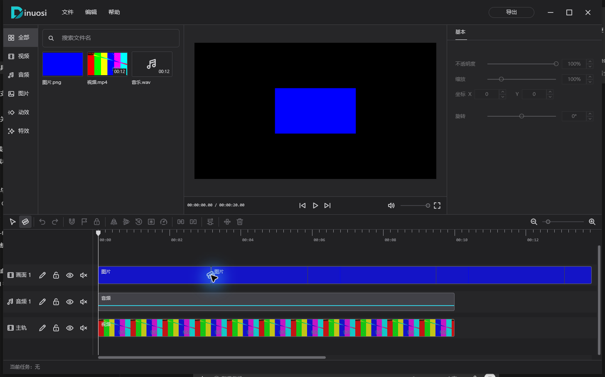

  

<h1 align="center">Dinuosi · 迪诺斯</h1>

本地优先的桌面视频剪辑软件，使用 Rust 与 GPUI 构建。

  <a href="#当前能力">当前能力</a> ·
  <a href="#开始使用">开始使用</a> ·
  <a href="docs/DEVELOPMENT.md">开发指南</a> ·
  <a href="docs/RPD.md">产品规划</a>

Dinuosi 将素材管理、画面预览和多轨时间线放在同一个工作区。素材保留在原目录，剪辑项目只保存引用与编辑信息。

目前支持 Windows x64、Linux x86_64 和 macOS（Apple Silicon / Intel）的源码构建与运行，处于早期开发阶段。平台环境与当前支持范围见 [跨平台支持](docs/CROSS_PLATFORM.md)。

## 当前能力

- **项目与素材管理**：创建、打开和重命名项目；导入、搜索、重命名或移除素材，保留离线素材引用。
- **多轨剪辑**：视频、图片和独立音频轨道；拖放、移动、裁边、刀片切割、多选、撤销与重做。
- **画面与声音调整**：位置、缩放、旋转、不透明度和音量；在预览画面中直接拖动、缩放和旋转素材。
- **关键帧与时间定位**：画面参数和音量的线性关键帧，磁吸、项目标记和片段锁定。
- **媒体预览**：视频与音频播放、音频波形、MIDI 播放、逐帧查看和全屏观看。
- **视频导出**：多轨时间线输出为 MP4 或 MKV，选择分辨率、帧率、码率与可用编码器；后台导出、进度与取消，已有文件不会覆盖。
- **界面与设置**：简体中文和 English，自定义快捷键、项目分辨率与帧率设置。

## 开始使用

源码构建与运行方法见 [开发指南](docs/DEVELOPMENT.md)。

1. 新建项目，选择名称和保存目录，或打开已有的 `project.dinuosi` 文件。
2. 通过“文件 → 导入素材”选择文件，或将文件拖入素材库。
3. 将素材拖入时间线，使用裁边、刀片和检查器调整片段，在预览区查看结果。
4. 编辑会保存到项目中，重新打开项目可继续编辑；点击标题栏“导出”，选择参数、文件名和输出文件夹生成视频。

素材采用路径引用，不会复制到项目目录。移动项目到另一台电脑时需同时保留源素材及其路径；源文件移动或删除后会显示“媒体离线”，恢复到原路径后可重新读取。移除库内素材不会删除源文件。

### 常用快捷键

| 操作 | 默认快捷键 |
| --- | --- |
| 播放 / 暂停 | `Space` |
| 选择工具 / 刀片工具 | `V` / `C` |
| 在播放头处切割选中片段 | `Ctrl+B` |
| 撤销 / 重做 | `Ctrl+Z` / `Ctrl+Shift+Z` 或 `Ctrl+Y` |
| 新建 / 打开项目 | `Ctrl+N` / `Ctrl+O` |
| 设置 | `Ctrl+,` |

完整快捷键可在“帮助 → 键盘快捷键”查看，并在设置中修改。

## 开发与贡献

[开发指南](docs/DEVELOPMENT.md)提供源码运行、检查和打包步骤。[架构说明](docs/ARCHITECTURE.md)介绍模块职责和数据边界；修改代码前请阅读 [协作约定](AGENTS.md)。

反馈问题时，请提供软件版本、操作系统版本、复现步骤和相关错误信息。媒体问题可附能复现问题的最小样本。

## 许可证

本项目采用 [MIT 许可证](LICENSE)。第三方组件与资源遵循各自许可。
